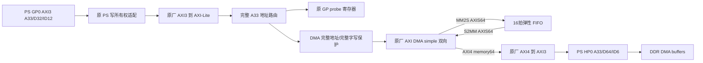

# DMA 回环 PL 交接 — 2026-10-12

交付源码提交：待最终提交后写入；对应身份见 `RELEASE.json`。接收本交付后 PL 任务结束，由 BSP 继续系统集成和上板。本文件不授权下载板卡或修改启动镜像。

## 范围与兼容性

用户已集中接受 `dma_loopback_v1` 最小硬件契约。唯一机器源为 `pl_interface/schema.json`，生成 Verilog/C 定义及表格。新 profile 不冻结历史 Draft 的 80B/128B 运动/遥测布局。旧所有数值常量和 GP profile 与 `0eecd84` 逐项比较一致；GP ABI VERSION1/CAPS0xf/FEATURES0x7、事务/快照/时间戳、0x80400000/4KiB、IRQ0/SPI82保持。新增 DMA 资源由独立 DT 节点发现，不改 GP feature 位。

新增生成头文件含 DMA 常量，规范 SHA 改变；BSP 应重新导入同提交生成物并更新其构建身份清单，不能沿用旧头文件 SHA。现有板测 GP 镜像及记录仍属于旧批次，不被这次仿真覆盖或改写。运动 RTL、Golden 源码/基线和 BSP 文件未修改。

## 集成入口与连接图

建议 BSP 替换原 `gp_ps_control_top` 实例为 **`dma_gp_ps_top`**，保持 GP0 各线和 common reset0 接线，增加 HP0 并使用本顶层完整 `f2p_irq` 输出。它已经包含原 GP 寄存器、原 PS 无WID所有权适配器、真实 GP转换器和自检过的共享 Lite 路由；不要再把原 GP实例并接到同一总线。



已有共享 GP互连时也可用 `dma_loopback_top`：入口是带 WSTRB 的 AXI-Lite A33/D32，模块自行完整窗口检查。该入口不是直接 PS GP0 全 AXI；不要提前截高位或把低10位地址直接接 DMA。

必须加入 `pl_dma/rtl/*.v`、原样 `pl_motion/rtl/gp_control_regs.v` 和 `gp_ps_write_adapter.v`、唯一 `pl_interface/generated/interface_defs.vh`，以及 `prepare_ip.py` 分期的两份完整厂商库。DMA库还需要原厂 `axi_dma_func_pkg.vh`、`axi_dma_param_pkg.vh` 包含目录。生成接线文件由 `generate_top.py` / `generate_shared.py`再生；不可手改后跳过 `--check`。

## 地址与 IRQ

| 功能 | CPU窗口 | 中断线 | DTS SPI / GIC INTID |
|---|---|---|---|
| 原 GP probe | 0x80400000，4KiB | f2p_irq[0] | 82 / 114，已独立板测 |
| DMA MM2S | 0x80500000，4KiB内原厂寄存器 | f2p_irq[1] | 83 / 115，待 BSP 板测 |
| DMA S2MM | 同一 DMA IP，通道寄存器偏移0x30 | f2p_irq[2] | 84 / 116，待 BSP 板测 |

两路新 IRQ 均高有效 level，按当前 TD `pl_dts_config.json` 的 irqNumBase82生成规则确认。本顶层 bit3–15为0。原厂 IOC/error状态清除控制其输出，不插入脉冲化；复位时DMA IRQ屏蔽。不要填写固定 Linux IRQ编号。

仅 DMA 窗口前1KiB可交给原厂，其余偏移 SLVERR；窗口外 DECERR。控制访问4B对齐、写WSTRB必须0xf；零/部分strobes拒绝。长度写1..65535，零或高位溢出拒绝；DDR地址8B对齐，非零address-MSB写拒绝，避免原厂窄字段静默alias。地址寄存器值是Linux设备DMA地址，不是用户指针。

`ADDRESS_MAP.json`保存当前 BSP expanded DTS全部可解析数字CPU资源（包含disabled节点）的窗口审计：新窗口无冲突，原GP窗口存在。当前PS address XML为空，不能当作完整硬件decode证明；BSP须对最终HPF、GP实际译码、DT和所有新增资源再审核。不会复制示例0x80000000等DMA/显示地址。

## 实际 HP0 接口

`audit_ps.py`只在 `pl_dma/build/ps` 修改复制的HP0使能，然后调用当前TD原厂xmlipgen。`HP0_PORTS.json`记录实际生成原始RTL身份及全部端口；不是仅据GUI勾选判定。

| PL端口 | PS端口尾缀 | 实际宽度/行为 |
|---|---|---|
| hp_araddr/hp_awaddr | slave_hp0_axi_araddr/awaddr | 33，DMA32地址补高位0 |
| hp_arid/awid/rid/bid | 同名尾缀 | 6；本DMA单master读写均ID0 |
| hp_arlen/awlen | 同名尾缀 | 4；真实协议转换器，不截AXI4 LEN8 |
| hp_arsize/awsize | 同名尾缀 | 2；8B拍SIZE=3，高位未丢非零有效值，仿真检查 |
| hp_arlock/awlock | 同名尾缀 | 1，无锁事务；转换器内部LOCK2为0 |
| hp_arqos/awqos | 同名尾缀 | 4，当前零QoS，无优先级承诺 |
| hp_rdata/wdata | 同名尾缀 | 64；WSTRB8，LAST/READY/VALID完整 |
| hp0_aclk | slave_hp0_axi_aclk | 同源H16 100MHz |

实际PS没有HP0 WID端口；转换器管理写命令/响应，内部WID不作为PS信号。仅一条DMA memory master，MM2S提供读、S2MM提供写，无额外多master仲裁。实际选用PS wrapper不导出HP0 arst_n；硬宏存在该输出，不得据此编造PL reset输入。BSP必须保证启动时GP/HP内部soft reset均释放；common PL reset release不等于HP已释放。

## IP、时钟和复位

当前安装 TD **Release_2026.1_SP2.200.067**，Anlogic AXI DMA1.0 / AXI Protocol Converter1.0；未经修改的受保护RTL由支持它的Questa执行。准确原文件/Component/头文件SHA及全部实例参数见 `SIM_RESULTS.json` 的 `real_ip`，交付校验会重新比较。直接参数化当前厂商库，不复制旧例wrapper，不使用stub，也未手工解密。

双向开启；SG/Micro/status-control stream关闭；memory/stream64、memory address32；burst16；DRE/SF双向开启；BTT字段16；ASYNC0。所有Lite/MM/stream/HP ACLK为同一H16 100MHz，频率参数均100000000。DMA输出USER4、ID5、DEST5经过FIFO原样透传，没有运动字段含义。

common `p2f_rst0_n`仅用于启动/整域epoch重建，异步assert、2拍同步release，复位同时影响GP时间戳和DMA。运行中DMA取消不能toggle该共同reset来代替恢复。DMA软件reset不复位原GP寄存器/时间戳。

FIFO额外组合观察两个原厂 `*_prmry_reset_out_n`；任一个低立即取消全部FIFO有效拍，两个都高后2拍同步放行。16拍capacity只指本PL FIFO数据128B，另含KEEP/LAST/sideband；原厂内部缓冲不计入此容量。非整包缓存，包可大于容量；满则上游背压，持有拍的所有字段稳定，TLAST按实际握手透传；正常不丢包、不跨包合并。先投同长度S2MM，再发MM2S；单条simple传输一包。

取消/错误恢复：BSP阻止新提交→DMAengine terminate_sync/相应驱动停止→协调复位两方向→确认reset完成/FIFO清除/没有旧回调或在途DDR访问→重新建立软件generation并投S2MM、再MM2S。单向reset也会清回环，但不允许据此让另一方向继续旧包。仅W1C、仅reset位自清或FIFO空不证明DDR静止，不能提前复用buffer。模拟whole-domain reset时DDR BFM同属reset epoch，不能把该试验当硬PS运行中reset安全证明。

## DTS及 BSP 构建要求

`configs/dma-candidate.dtsi`为唯一profile生成的 **disabled候选**，可供BSP审查，未宣称已与最终驱动dtc/probe验证。关键项：`compatible="anlogic,axi-dma"`，`#dma-cells=1`，addrwidth32，sg-length-width16，两child channels stream64/DRE，interrupts `<0 83 4>` / `<0 84 4>`，同一真实100MHz时钟。clock-names及channel reg命名须与BSP实际编译驱动核对，不能用候选替代绑定审查。Linux使用DMAengine和DMA mapping/coherent API，32-bit mask，至少8B地址对齐；不得复制裸机固定DDR地址或使用用户态任意地址。

**当前TD DTS生成模板固定加入 `anlogic,include-sg`，必须对本simple profile移除。** 模板有该属性不能证明硬件SG=1。BSP须核对驱动simple分支、BTT上限、完成/错误长度、cache所有权、两个中断和terminate行为；HP不假定自动snoop。首轮可用coherent/CMA，保持当前DDR配置，不把本交付当DDR供电/训练验收。

直接实例原始PS绕过custom-wrapper属性加载。BSP必须像已修复GP一样，将厂商生成PS property Tcl按**实际层级**加载；只映射实例路径、保留属性值，不能手填虚构时钟。新增HP0后重生成实际PS/HPF，再核对原GP和新HP clock captures。未生成或部署BOOT.bin/FSBL/bitstream。

## 验证与剩余限制

数值与原始日志见 `VALIDATION.md`、各 `*_RESULTS.json` 和 `reports/evidence.zip`。独立/共享入口都使用真实DMA和真实HP转换器的self-checking bench；共享入口另有原GP回归。独立FIFO多容量测试满空、随机背压、sideband、复位；集成测1/7/8/9/15/16/31/127/129/255/256/4095/4096/4097/65535/8193B及恢复包，递增/固定/扰动/反码数据，guard字节、KEEP/TLAST、延迟HP响应、满16拍、跨GP/DMA读写归属、在途复位、协调soft reset恢复。原单轴/四轴/连续/GP/接口/Golden回归已运行。

隔离真实PS＋GP0＋HP0参考已布局布线通过：setup+3.117ns/hold+0.020ns，GEN_PL_HP0和GEN_PL_GP0S均100MHz，critical warning0。它使用复制的PS配置和本交付模块，不是BSP最终HPF/FSBL/镜像签核。

OOC串行观测夹具保持GP和DMA路径，但含额外输入/观测寄存器，使用参考speed2；IO自动位置、未设IO delay不能当板级约束。native checker两项厂商内部悬空节点保留，Questa有受保护厂商内部连接位宽warning49项；没有自研公开端口位宽warning。警告未屏蔽，不能把功能仿真通过当完整协议/厂商IP认证。

可开始BSP源码集成的条件：固定源码/IP/唯一规范校验通过，实际PS HP0启用/端口匹配，GP共享顶层完整接线及PS属性加载就绪。本交付满足PL仿真/OOC时序门槛；**部署仍由BSP完成最终系统STA/DRC、remaining诊断审核、HPF/FSBL/驱动/DT和镜像配套审核后决定**。新IRQ、DDR/cache/吞吐、长期背压、重复恢复与实板回环未验证；不接运动FIFO或电机，不把原GP板测通过扩展为DMA板测通过。

## 复现

```powershell
python pl_interface/generate.py --check
python pl_dma/prepare_ip.py
python pl_dma/generate_top.py --check
python pl_dma/generate_shared.py --check
python pl_dma/generate_dts.py --check
python pl_dma/audit_ps.py
python pl_dma/audit_address_map.py
python pl_dma/tests/test_contract.py
python pl_dma/tests/run_components.py
python pl_dma/tests/run_sim.py
python pl_dma/tests/run_sim.py --shared
python pl_dma/build_td.py --place-route
python pl_dma/build_soc_reference.py
python pl_dma/tests/run_regressions.py
python pl_dma/verify_delivery.py
```

Questa2025.2使用 `-batch`（本机`-c`有RPC问题）；Icarus12仅跑自研模块，不能跑保护IP；TD命令必须检查完成marker，exit0不足以证明成功。BSP配置更新后需重新审计，不能自动修改原GP/DDR/中断约束。
