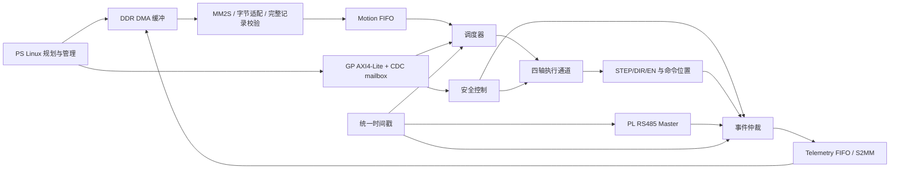

# PS/PL Interface Specification — Draft v0.1 / 部分冻结

本轮已确认的时间、位宽、停止/位置、规范组织和首批DMA选择见DECISIONS末节。下文保留“候选”字样的整体组合仍须审查；已确认选择不因其所在段落Draft而失效。

2026-10-09 单轴补充确认覆盖下文对应候选：STEP 上升沿/闲置低、DIR=1 正向，故障/STOP/欠流同拍优先；REBASE/失能/复位/停止与 EN 的具体最小契约见 DECISIONS 最新节及 pl_motion/README.md。下文系统状态表和记录布局其余内容仍 Draft。单轴模块无 FIFO，队列清空、维护授权和全历史 session 唯一性属于上游责任。

同日四轴扩展已确认：共同 Nmax 槽和整数余数分配、PL 逻辑输出同槽边沿同拍，单点整组预检/精确 duration/统一停止。实现契约见 pl_motion/FOUR_AXIS.md；正常点 done 保留会话、欠流显式输入，未实现下文系统记录生命周期的连续 FIFO/END/暂停部分。

## 1. 边界与不变量

PS Linux 负责任务、规划、时间参数化、插补、Delta IK、CAN；PL 负责四轴 STEP/DIR/EN、同步执行、命令计数、整机回零/限位/联锁/停止、RS485 Master、时间戳。驱动器负责单轴闭环；外部电路负责最终急停失能。NPU 不直接执行运动。

四轴绝对目标减**已实际输出 STEP 的命令位置**得到剩余增量。接收点、预取点、上一目标都不能更新命令位置。编码器反馈独立存储，不能悄悄修正此计数。物理映射、计数正向对应 DIR 极性、回零基准另行标定。

GP AXI4-Lite 控制；运动和遥测 FIFO 经 HP/DMA 访问 DDR。100MHz 为运动基础时钟。时间戳 u64、每次 PL 上电初始化完成从零累加已确认，其余频率/复位语义见待定决策。RS485 三信号 TX/RX/DE、半双工、CHECKSUM-8，STP 期间轮询；节点使能独立于轴使能，M4 可不在线。

## 2. 数据流与内部逻辑接口



以下逻辑接口不冻结具体 IP 端口。时间、持续时间、反馈年龄用 timestamp tick；脉冲参数用 100MHz cycle；绝对位置用 signed step；计数次数用 unsigned pulse。

| 边界 / 方向 | 数据与握手 | 时钟、复位、CDC责任 |
| --- | --- | --- |
| DMA→记录适配器 | 候选64bit data、8bit keep、last、valid/ready；低字节先；last=一条记录结束 | DMA域；桥拥有DMA复位与部分记录清除 |
| 记录适配器→Motion FIFO | 全部80字节记录、valid/ready；完整校验才一次提交 | DMA域到100MHz域异步FIFO；不逐位同步数据 |
| FIFO→调度器 | point、valid/ready；握手=接受待执行点，不等于执行 | 100MHz，共同session；调度器管理取消 |
| 调度器→四通道 | 四轴delta（signed65）、duration_cycles、mask、session、seq；原子group_req / group_ack | 同100MHz；只有所有启用通道和安全门均ready才发共同起始事件 |
| 通道→计数/事件 | 每个实际有效STEP边沿：axis、direction、pulse_event；point_done/cancel含seq和实际位置 | 同100MHz；计数与引脚寄存器同一事件，禁止按计划数预加 |
| GP→配置/控制 | 稳定影子参数+transaction_id，req/ack mailbox；快照反方向 | GP域↔运动域，由mailbox拥有CDC；来源保持payload到ack |
| 安全→通道 | stop_pending锁存、reason、event_tick；最高调度优先级 | 同运动域；异步输入先同步；外部急停另有独立硬件链 |
| RS485→事件仲裁 | node/axis、poll_seq、raw/status、rx_done_tick、valid/ready | 候选100MHz UART clock-enable；若独立时钟则完整事件异步FIFO |
| 事件→Telemetry FIFO | 全部128字节；valid/ready；full按明确丢帧策略 | 运动域→DMA域异步FIFO；不可背压STEP计数/安全路径 |

所有 valid&&!ready 时 payload、keep、last、标识稳定，valid 不得等待ready才拉高；仅 valid&&ready 发生一次传输。取消采用独立握手/epoch失效，不改写正在背压的有效记录；适配器排空旧数据但不提交。记录接收资源必须足够保存一整条，CRC失败不可有半条进入执行FIFO。

RS485 等待应答不得阻塞调度器/执行通道。采集失败只交给通信策略和安全状态机判断，不能直接拉低运动ready。

## 3. 记录生命周期

1. PS提交：填完DDR缓冲、做同步/屏障、交DMA。此时尚未被PL接收。
2. DMA完成：字节传输完成；不证明CRC、session、序号及目标获接收。
3. PL接收：完整格式、CRC、版本、session/序号/配置掩码检查通过，进入FIFO，更新accepted_seq。
4. 执行开始：基于当前实际命令位置再计算delta，验证时间可行性，原子启动，记录start_tick。
5. 执行完成：所有应输出脉冲已计数、STEP低且末低脉宽满足、时间区间结束；done_seq更新。零位移点仍等待其持续时间。
6. 取消：安全/STOP/DMA错误使session失效，尚未执行点全部取消；在执行点报告实际已输出数和cancel_tick，不更新done_seq。旧DMA到达不得重新唤醒运动。

## 4. 时钟、复位与位置有效性

候选运动/安全/计数/时间戳域100MHz；GP与DMA时钟独立，取自实际生成的PS/IP配置，不据示例固定频率。各域复位异步断言、同步释放；FIFO两端reset完成及mailbox epoch一致后才ready。CDC约束与静态检查另行验证。

已确认时间戳1MHz，由100MHz除100；duration_tick精确乘100为cycle，不使用浮点。初始化完成条件候选：时钟稳定、各域复位释放、CDC握手完成、STEP inactive/EN disabled、计数初始化完成。此时timestamp=0开始，不等待Linux或回零。已确认STOP/清错/DMA复位保持时间戳、PL重配置建立新epoch；清队列保持及PS重新绑定session是候选细节。掉电无可靠epoch持久计数，由Linux boot/session上下文识别；wrap前禁止新运动并换epoch的流程待确认，不依赖有符号时间比较。

上电计数数值0但position_valid=0；软件不得把它当机械零位。候选位置初始化：经完整PL整机HOME成功，或禁止EN/无活动/队列空且人工确认的维护REBASE事务；赋四轴signed64并设置valid。失能/外部急停/人工移位可能使有效性丧失；候选主动撤销valid，绝不自动追赶旧目标或自动重新使能。

## 5. 状态与独立动作

| 状态 | 进入/离开候选条件 |
| --- | --- |
| POWER/INIT | 输出inactive、EN禁用；完成初始化→NOT_READY |
| NOT_READY | 配置valid但位置未建立；HOME/维护REBASE完成→READY；任何联锁→FAULT |
| READY | 配置valid、启用轴位置valid、安全条件满足；OPEN_SESSION预缓存、显式ENABLE满足延迟后START→RUNNING |
| RUNNING | 执行完整点；END完成→READY并关闭session；PAUSE→PAUSING；STOP→STOPPING；故障→STOPPING并锁存fault |
| PAUSING/PAUSED | 候选完成当前点后进入PAUSED，保留队列/session/EN；RESUME显式继续相对时间，不追赶墙钟；任何联锁覆盖暂停 |
| STOPPING | 禁止新有效边沿，按高/低和DIR保持规则结束当前脉冲；取消当前点/队列，关闭session；有锁存fault→FAULT，否则READY或NOT_READY |
| FAULT | 禁止START；CLEAR_FAULT只在源不再有效且停止完成后清锁存；返回READY/NOT_READY，EN仍按独立动作，不自动恢复 |
| HOMING | 只有非RUN且安全允许；PL整体流程；完成设置位置、取消旧session；速度/顺序/输入仍TBD |

STOP=停止执行并失效session；DISABLE=释放EN并按策略撤销position_valid；CLEAR_FAULT=确认源解除并清锁存；FLUSH=停止态清队列/部分记录；REBASE=维护位置标定；DMA_RESET=数据链恢复。动作独立，命令不得别名为含糊reset。

正常STOP推荐结束在高电平的当前脉冲并禁止下一有效边沿；不是减速停车。安全减速需要PS预规划停机轨迹或经另行批准的PL算法，当前不能承诺。欠流候选区间边界停止并失效session，不无限保持RUN。

## 6. 外部接口与停止时序草案

STEP/DIR/EN输出四组逻辑信号；电压3.3V已确认。有效边沿、极性、负载/驱动电流、缓冲、线缆延迟、EN enable/disable延迟均TBD。文档用逻辑 STEP active / inactive 表述；候选有效边沿为进入active，不先冻结物理上升沿。

Homing/Limit/Alarm/E-stop inputs：输入数量、轴关联、常开/常闭、有效极性、滤波周期、故障断线判别待定。每个普通异步输入至少双级同步，配置化连续稳定去抖（cycle），保留raw与filtered诊断；机械限位安全响应是否旁路去抖需风险评估。E-stop外部硬失能不能经Linux或去抖等待，PL同步采样只作停止/日志；硬失能造成截短脉冲须报告，不宣称满足驱动输入时序。

候选关键时序（所有数值参数未冻结）：

```text
tick t0:       实际有效STEP边沿 -> cmd_position += sign；pulse_total++
t0..t0+H:      STEP active
fault at tf:   latch cause/time；禁止新的有效边沿，冻结新调度
max(tf,t0+H):  STEP inactive（不截短正常PL停止的高脉宽）
再等待L:       所有通道inactive，STOP完成/取消事件
DIR变化:       不早于最后有效边沿+Q_hold；下一有效边沿前至少Q_setup
EN释放:        独立策略，在pulse-safe完成后；外部硬急停可能更早
```

有效边沿与故障同拍候选“故障优先、不产生边沿”；若前一拍已输出则保留计数，不能回滚。计数表示FPGA引脚已输出脉冲，转换模块/外部急停/电气失败可能使驱动未识别；日志需分开pulse_count与position_valid，不能声称编码器到位。

同步验收保持“对应STEP边沿偏差<50μs”。推荐先以相同调度槽中标记的边沿为对应边沿，在PL引脚测量并另测驱动STP输入延迟；不同轴不同步数无需全部边沿重合。对应规则、测量点仍须用户确认；point_start/done同步不替代该指标。

## 7. 后续RTL验证责任

AXI随机AW/W顺序、WSTRB/非法访问、mailbox并发与reset；CDC分析/约束；记录截断/CRC/session取消；DDA每轴脉冲数与高低/DIR断言；故障所有相位注入；不同轴数量对应边沿测量；DMA背压/错误/复位；RS485超时并发运动。当前宿主测试不覆盖这些硬件行为。
