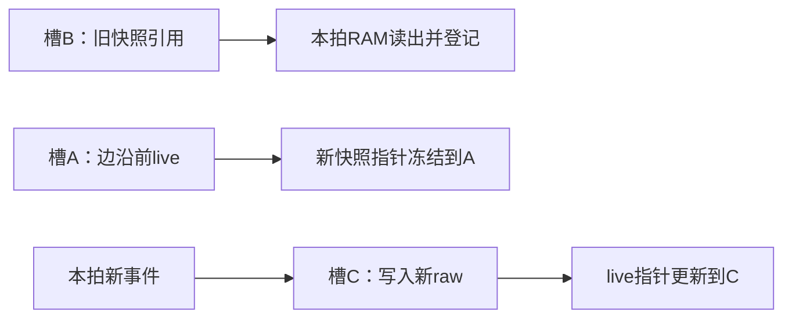

# 第二轮资源与时序优化候选

本轮依据用户“再执行一轮优化，按照我们讨论的方向进行”授权实施。上一轮候选49e8ac6/5f88d0f仍按用户决定暂不通过；旧发布、证据、镜像及工作区其他文件保持。本轮未操作板卡/COM4/存储，未生成部署镜像，未执行REBASE/ENABLE/START。

## 身份和接口

开始提交b0de44a309869af1ea534b976452847305ff95dc，包含并发PS/HMI文档交付。源基线和上一轮真实顶层报告身份见BASELINE.json与baseline/。仍使用唯一schema，冻结旧GP、MOT2 72B、采集32B、新遥测64B CRC、IRQ、错误码和旧profile数值不变；生成定义检查及596项旧数值检查必须通过。

改动仅涉及四个实现文件：rs485_latest_cache.v、rs485_multirate.v、rs485_gp_regs.v、rs485_telem_regs.v；原rs485_telemetry FIFO256 ERAM实现保持。verify_input.py只在明确round2/parent身份下扩展上述三个原未授权RTL路径，仍校验候选精确哈希、git中f447116原文件、冻结证据、全部IP、schema及旧数值；默认旧门禁继续拒绝新源码。七项正反门禁测试见identity/。

## 实现

1. collector的32bit饱和计数将65bit求和/比较改成33bit低字加法、增量高32bit非零检测及进位判断。64bit增量、参数计算原有回绕及饱和值保持。利用原64周期除法等待窗口登记missed/scheduled旧值，在原div_done提交边沿更新，未增加调度周期或移动统计可见边沿。移除了提交路径上的动态数组读选择。
2. GP SNAP_SUBMIT的完整A33窗口/对齐/偏移译码在原AW登记边沿完成；WD/WSTRB/水位/reset仍在原提交边沿判定。快照所有字段保持同拍采集。
3. cache把两个完整256bit raw记录的live/frozen副本改为两个全局ERAM存储体，每行三槽。冻结170bit元数据/行、时间和五组配置；raw通过冻结指针引用。每次写入同时避开旧快照槽和当前live槽，因此同拍读旧快照、捕获新快照和新事件写入时，读写端口没有同地址冲突。每个RAM每拍最多一写一读，valid事件同时写good/last，失败仅写last；没有逐行采样、拷贝任务、冻结采集或新的漏采。
4. since-reset written位与generation seen位分离：reset后尚未初始化的raw读为零，generation变化保留旧raw，与原实现一致。RAM不清内容，用指针/元数据隔离；last_valid、last_result、全部generation/revision、updates及所有保留字段继续输出。

三槽在“AR读旧快照＋替换快照＋更新同拍”时的含义如下；good/last各自独立应用此规则：

同拍写入既不触碰B，也不触碰A；已读出的256bit raw和对应元数据进入读流水，后续R背压不再占用RAM槽。因此不依赖器件跨端口同地址read-during-write的未确定结果。无快照替换时，写入也遵守同一排除规则，在非冻结槽间轮转。

唯一允许的接口周期变化：**有效遥测cache行读取AR接受后，RVALID增加一个100MHz时钟等待周期**。AR边沿采样RAM地址和同版本冻结元数据；端点下一拍登记完整RDATA/RRESP，背压期间保持稳定。未捕获快照/非法地址/非cache寄存器的原响应周期保持。读pending期间不接受新AR；generation变化或新快照不得改变已经接受的读，reset仍取消原在途响应。

后续集成必须将四个RTL作为同一候选使用，尤其不能混用旧cache与新telem_regs，或新cache与旧telem_regs。生成头文件/ABI、PS/IP、IO和约束不变，无需新PS配置。复现顺序：`python pl_rs485/optimization/round2/run_control_diff.py --tag <新tag>`；`run_ram_diff.py --tag <新tag>`（另加`--slaves 1`验证旧profile）；串行完整回归及实际参数真实IP检查；`round2/prepare_top.py --tag <新tag>`；`bsp/telemetry/build_hardware.py --work-dir telemetry_opt_<新tag>`；`optimization/audit_top.py --tag <新tag>`；`round2/analyze_top.py --tag <新tag>`。所有tag必须新建，禁止覆盖旧证据。封存后以ROUND2_RELEASE.json绑定的源码提交和evidence.zip核对；`round2/seal.py --source-commit <提交> --verify`执行身份复核。

## 验证方式

- run_control_diff.py：归档上一轮collector/GP RTL作独立逐拍oracle；原UART线级从机、全部原场景保留，GP1969拍及collector10420977拍一致；另65536项饱和极值/随机函数差分。
- run_ram_diff.py：最初冻结完整快照RTL作独立字值oracle，仅在测试端登记其原AR边沿数据以对齐允许的一拍读延迟。512个地址、signed/enum/失败、配置/时间/generation/wrap、未初始化、饱和和reset均保留；增加12000拍连续读/捕获/更新竞争。3节点和1节点profile分别128344项检查。
- 同一运输FIFO、CRC、包边界/credit/结果/IRQ原场景、全环满FIFO pop/push及单条刷新继续比较。337项断言、339帧/24包；额外AR/快照/事件同拍、generation改变及长R背压。
- 受影响完整回归由上一轮串行runner使用独立tag opt2r1运行；真实受保护IP与Questa测试串行，不使用stub。原冻结结果/证据字节在runner finally中恢复。
- 完整实际顶层由round2/prepare_top.py准备独立telemetry_opt_r2main工程；保留同一器件/参考speed2、10ns、九根真实J12运动OREG、实际500cycle/100kHz/M4禁用参数、RS485真实IO、GP0及HP0/HP1和全部PS/IP/约束哈希。

## 中间方案和失败记录

opt2cache1组件证明14ERAM映射、功能通过，route+0.396/+0.020ns。对RAM地址乘3进行定宽移位相加后，opt2cache2 route+0.871/+0.035ns，Slice5114/REG6388/ERAM14/DSP1。残留1个DSP来自170bit元数据的变量索引乘法；不能宣称地址移位化已清零DSP，最终须报告这一代价。

ram_cow3新增测试错误地复用AXIS监视器的held变量作为RDATA期望值，并在旧递增ID测试之前使用新大ID；保留失败日志。改用专属检查值并将场景移到既有ID序列之后，ram_cow4通过，未修改实现或放宽断言。

## 完整报告原则

最终资源、setup/hold、原0.080/0.093ns路径、局部拥塞及check_timing以下方完成的实际route报告为准；不得用组件资源差值作为整机收益。

S2MM-only IP的SYN-5066、RS485外部时序/电气资格、实物速度等级以及Linux实板RX/恢复/DDR供给等独立发布阻塞保持。资源时序构建通过不等于发布签核或用户优化验收通过。

## 本轮完整实际顶层结果

|项目|原基线7681c69|上一轮候选49e8ac6|本轮|本轮相对上一轮|
|---|---:|---:|---:|---:|
|LUT6|32720|28644|26090|-2554|
|Slice|44346|41049|33222|-7827|
|Slice寄存器|48872|47328|34381|-12947|
|ERAM|34|46|58|+12|
|DSP|15|5|6|+1|

本轮再释放7827 Slice（14.9143个百分点）；相对原基线累计释放11124（21.1966个百分点）。当前Slice占用63.3041%，剩余19258。
最终100MHz route setup +0.305ns、hold +0.020ns，双corner，STA coverage 99.99%。所有阶段明细见TOP_COMPARISON.json。

报告列出的最差setup路径（最多展示前十项，未列出不能解释为对应扇出已归零）：
- 0.305ns：ps/DR1_PHY_PROCESSOR_SYSTEM_Inst.slave_hp0_axi_rvalid (rising edge triggered by clock ps/DR1_PHY_PROCESSOR_SYSTEM_Inst.GEN_PL_HP0  { rise@0.000000ns  fall@5.000000ns  period=10.000000 }) → a2_dir_syn_6.ce (rising edge triggered by clock board_100m  { rise@0.000000ns  fall@5.000000ns  period=10.000000 })；8.910ns (cell 2.407ns (27%), net 6.503ns (73%))；最大fanout 40。
- 0.413ns：ps/DR1_PHY_PROCESSOR_SYSTEM_Inst.slave_hp0_axi_rvalid (rising edge triggered by clock ps/DR1_PHY_PROCESSOR_SYSTEM_Inst.GEN_PL_HP0  { rise@0.000000ns  fall@5.000000ns  period=10.000000 }) → a2_dir_syn_6.ce (rising edge triggered by clock board_100m  { rise@0.000000ns  fall@5.000000ns  period=10.000000 })；8.802ns (cell 2.358ns (26%), net 6.444ns (74%))；最大fanout 40。
- 0.497ns：control/core/fabric/dma_core/motion/kernel/executor/disabling_reg[3]_syn_5.clk (rising edge triggered by clock board_100m  { rise@0.000000ns  fall@5.000000ns  period=10.000000 }) → a2_en_syn_4.ce (rising edge triggered by clock board_100m  { rise@0.000000ns  fall@5.000000ns  period=10.000000 })；9.237ns (cell 1.501ns (16%), net 7.736ns (84%))；最大fanout 31。
- 0.507ns：control/core/fabric/dma_core/motion/receiver/record_data_reg[406]_syn_2.clk (rising edge triggered by clock board_100m  { rise@0.000000ns  fall@5.000000ns  period=10.000000 }) → control/core/fabric/dma_core/motion/kernel/planning_base_reg[208]_syn_2.cea (rising edge triggered by clock board_100m  { rise@0.000000ns  fall@5.000000ns  period=10.000000 })；9.273ns (cell 2.173ns (23%), net 7.100ns (77%))；最大fanout 41。
- 0.524ns：ps/DR1_PHY_PROCESSOR_SYSTEM_Inst.slave_hp0_axi_rvalid (rising edge triggered by clock ps/DR1_PHY_PROCESSOR_SYSTEM_Inst.GEN_PL_HP0  { rise@0.000000ns  fall@5.000000ns  period=10.000000 }) → a0_dir_syn_6.ce (rising edge triggered by clock board_100m  { rise@0.000000ns  fall@5.000000ns  period=10.000000 })；8.689ns (cell 2.407ns (27%), net 6.282ns (73%))；最大fanout 40。
- 0.589ns：control/core/fabric/dma_core/motion/receiver/record_data_reg[394]_syn_2.clk (rising edge triggered by clock board_100m  { rise@0.000000ns  fall@5.000000ns  period=10.000000 }) → control/core/fabric/dma_core/motion/kernel/planning_base_reg[208]_syn_2.cea (rising edge triggered by clock board_100m  { rise@0.000000ns  fall@5.000000ns  period=10.000000 })；9.191ns (cell 2.013ns (21%), net 7.178ns (79%))；最大fanout 41。
- 0.606ns：control/core/fabric/dma_core/motion/receiver/record_data_reg[220]_syn_2.clk (rising edge triggered by clock board_100m  { rise@0.000000ns  fall@5.000000ns  period=10.000000 }) → control/core/fabric/dma_core/motion/kernel/planning_base_reg[208]_syn_2.cea (rising edge triggered by clock board_100m  { rise@0.000000ns  fall@5.000000ns  period=10.000000 })；9.173ns (cell 2.067ns (22%), net 7.106ns (78%))；最大fanout 41。
- 0.608ns：control/core/fabric/dma_core/motion/kernel/session_id_reg[40]_syn_2.clk (rising edge triggered by clock board_100m  { rise@0.000000ns  fall@5.000000ns  period=10.000000 }) → control/core/fabric/dma_core/motion/kernel/planning_base_reg[208]_syn_2.cea (rising edge triggered by clock board_100m  { rise@0.000000ns  fall@5.000000ns  period=10.000000 })；9.169ns (cell 2.121ns (23%), net 7.048ns (77%))；最大fanout 43。
- 0.632ns：ps/DR1_PHY_PROCESSOR_SYSTEM_Inst.slave_hp0_axi_rvalid (rising edge triggered by clock ps/DR1_PHY_PROCESSOR_SYSTEM_Inst.GEN_PL_HP0  { rise@0.000000ns  fall@5.000000ns  period=10.000000 }) → a0_dir_syn_6.ce (rising edge triggered by clock board_100m  { rise@0.000000ns  fall@5.000000ns  period=10.000000 })；8.581ns (cell 2.358ns (27%), net 6.223ns (73%))；最大fanout 40。
- 0.634ns：control/core/fabric/dma_core/motion/receiver/record_data_reg[201]_syn_2.clk (rising edge triggered by clock board_100m  { rise@0.000000ns  fall@5.000000ns  period=10.000000 }) → control/core/fabric/dma_core/motion/kernel/planning_base_reg[208]_syn_2.cea (rising edge triggered by clock board_100m  { rise@0.000000ns  fall@5.000000ns  period=10.000000 })；9.146ns (cell 2.049ns (22%), net 7.097ns (78%))；最大fanout 41。

完整拥塞原文（各阶段不能混为一个指标）：
- PHY-1001 : top1  = 112.99 (V 69.10, H 105.83, I 109.78, O 135.07)
- PHY-1001 : top1  = 110.08 (V 62.90, H 105.87, I 80.79, O 95.24)
- PHY-1001 : top1  = 92.68 (S 63.34, N 66.73, E 78.66, W 91.52, I 62.62, O 84.93)
- PHY-1001 : top1  = 87.82 (S 64.79, N 67.34, E 76.04, W 86.68, I 62.49, O 82.60)
- PHY-1001 : top1  = 87.97 (S 63.77, N 67.37, E 76.40, W 86.59, I 63.65, O 85.14)
- RUN-1001 :   No local congestion issue, and most congested 1% tile average routing util is 83.594595
- PHY-1001 : top1  = 86.50 (S 63.57, N 67.29, E 75.99, W 84.88, I 63.65, O 85.10)
- PHY-1001 :   Iter. 1: runtime[   4.8s]; rr_path[ 165985]; Path[overflow =  121362, finished =   44623].
- PHY-1001 :   Iter. 2: runtime[  54.0s]; rr_path[ 105177]; Path[overflow =   87400, finished =   78585].
- PHY-1001 :   Iter. 3: runtime[  60.1s]; rr_path[  74184]; Path[overflow =   56108, finished =  109877].
- PHY-1001 :   Iter. 4: runtime[  64.9s]; rr_path[  46549]; Path[overflow =   30773, finished =  135212].
- PHY-1001 :   Iter. 5: runtime[  80.5s]; rr_path[  23930]; Path[overflow =   11951, finished =  154034].
- PHY-1001 :   Iter. 6: runtime[  82.5s]; rr_path[   8888]; Path[overflow =    3541, finished =  162444].
- PHY-1001 :   Iter. 7: runtime[  83.7s]; rr_path[   3334]; Path[overflow =     594, finished =  165391].
- PHY-1001 :   Iter. 8: runtime[  85.4s]; rr_path[   1400]; Path[overflow =      50, finished =  165935].
- PHY-1001 :   Iter. 9: runtime[  86.8s]; rr_path[   1020]; Path[overflow =      16, finished =  165969].
- PHY-1001 :   Iter.10: runtime[ 102.1s]; rr_path[    807]; Path[overflow =       0, finished =  165985].
- PHY-1001 :   Iter.11: runtime[ 133.4s]; rr_path[    597]; Path[overflow =       0, finished =  165985].

### 定点路径复核与剩余热点

从同一gp_route.db只读恢复、重新载入原约束并执行final STA；replay最差setup仍为+0.305ns，未重新布局布线。定点集合及原始路径见timing_probe/targeted*.tcl与*.timing。
- collector_missed最差setup 2.140ns：control/core/fabric/rs485/collector/divider/remainder_reg[3]_syn_2.clk (rising edge triggered by clock board_100m  { rise@0.000000ns  fall@5.000000ns  period=10.000000 }) → control/core/fabric/rs485/collector/missed_reg[267]_syn_2.ima (rising edge triggered by clock board_100m  { rise@0.000000ns  fall@5.000000ns  period=10.000000 })；7.566ns (cell 1.591ns (21%), net 5.975ns (79%))；该路径最大fanout 32。
- collector_prefetch_pins最差setup 1.739ns：control/core/fabric/rs485/collector/selected_reg[0]_syn_22.clk (rising edge triggered by clock board_100m  { rise@0.000000ns  fall@5.000000ns  period=10.000000 }) → control/core/fabric/rs485/collector/max_late_reg[96]_syn_2.cea (rising edge triggered by clock board_100m  { rise@0.000000ns  fall@5.000000ns  period=10.000000 })；8.050ns (cell 1.346ns (16%), net 6.704ns (84%))；该路径最大fanout 52。
- collector_scheduled最差setup 1.219ns：control/core/fabric/rs485/collector/engine/poll_timer_reg[6]_syn_5.clk (rising edge triggered by clock board_100m  { rise@0.000000ns  fall@5.000000ns  period=10.000000 }) → control/core/fabric/rs485/collector/scheduled_reg[422]_syn_2.ceb (rising edge triggered by clock board_100m  { rise@0.000000ns  fall@5.000000ns  period=10.000000 })；8.568ns (cell 1.304ns (15%), net 7.264ns (85%))；该路径最大fanout 34。
- gp_snapshot_decode最差setup 2.552ns：control/core/fabric/rs485/regs/aw_snapshot_reg_syn_3.clk (rising edge triggered by clock board_100m  { rise@0.000000ns  fall@5.000000ns  period=10.000000 }) → control/core/fabric/rs485/regs/access_error_reg[0]_syn_27.ic (rising edge triggered by clock board_100m  { rise@0.000000ns  fall@5.000000ns  period=10.000000 })；7.238ns (cell 2.008ns (27%), net 5.230ns (73%))；该路径最大fanout 13。
- gp_snapshot_capture最差setup 1.139ns：control/core/fabric/rs485/collector/selected_reg[0]_syn_22.clk (rising edge triggered by clock board_100m  { rise@0.000000ns  fall@5.000000ns  period=10.000000 }) → control/core/fabric/rs485/collector/max_late_reg[262]_syn_2.ceb (rising edge triggered by clock board_100m  { rise@0.000000ns  fall@5.000000ns  period=10.000000 })；8.650ns (cell 1.572ns (18%), net 7.078ns (82%))；该路径最大fanout 52。
- gp_snapshot_capture_pins最差setup 2.472ns：control/core/fabric/telemetry/regs/wd_reg[20]_syn_2.clk (rising edge triggered by clock board_100m  { rise@0.000000ns  fall@5.000000ns  period=10.000000 }) → control/core/fabric/rs485/regs/snapshot_reg[14841]_syn_2.ceb (rising edge triggered by clock board_100m  { rise@0.000000ns  fall@5.000000ns  period=10.000000 })；7.302ns (cell 1.045ns (14%), net 6.257ns (86%))；该路径最大fanout 3392。

原collector动态选择→饱和统计写回的单拍组合链已经拆分；当前按整个missed相关寄存器集合核对，不把综合重命名后的路径称作原物理路径一一对应。GP分别核对从aw_snapshot出发、逻辑快照选择集合、以及snapshot命名Slice的CE引脚集合。物理Slice会混合打包其他逻辑：prefetch命名Slice的输入查询终止于max_late，snapshot命名Slice的CE路径来自telemetry控制；这些是覆盖共用Slice的保守集合，不能把物理实例名当作逻辑功能或宣称精确的一一对应。各原始集合、实际起终点均保留，上列fanout也不代表整个设计的最大扇出。

全局剩余最差路径为HP0 RVALID至a2_dir输出寄存器CE，data 8.910ns（net 6.503ns，73%），最大fanout40；board_100m域内最差为运动executor disabling至a2_en CE，setup+0.497ns，net 7.736ns。运动/HP0路径仍有较多布线延迟，本轮没有改动运动算法或DMA架构，+0.305ns不能证明后续安全/HOME一定放得下。

同一布局阶段最拥塞1% tile平均利用率94.925676%→83.594595%，诊断由Local congestion issue exists变为No local congestion issue；最终wire length 17009600→11810720（下降30.56%），detail routes 198878→165985，最终overflow为0。不能将这些不同指标合并成“所有局部利用率低于100%”。

route.area的DataNet扇出分布：51–100负载网178→136，101–500负载网49→8，>500负载网1→0。平均扇出2.15→2.24，因低扇出网数量同时减少，不能宣称平均扇出也下降。这是工具DataNet分类，不能当作全网扇出上限：CE控制仍有3392负载，telemetry/regs/mux147_syn_2[1023]单段布线3.557ns；相关物理CE路径setup+2.472ns。复位网也仍有fanout1523，逻辑prefetch查询最差recovery+4.034ns，原始collector_prefetch.timing保留。高扇出尚未全部消除，后续可继续审查控制分发，但本轮不再未经验证地改变实现。

最终顶层cache实际映射12ERAM/1DSP，独立组件映射14ERAM/1DSP；真实输入的已知常量位引起差异，收益只使用顶层总量。两个RAM各64×256bit、每行三槽，共保留15行good/last完整raw与冻结指针；FIFO256、原GP诊断FIFO及全部可观察字段由差分/真实IP测试和层级映射共同核对。

round2_dsp.rpt复核新增cache物理DSP mult0_syn_58（[85,96]），其内部辅助单元mult0_syn_59不是第二个物理DSP；planner仍4个、collector仍1个，全顶层共6个。上一轮清除的五组period×3共10个DSP仍未恢复，本轮新增的是元数据变量索引相关乘法，故相对原基线净少9个DSP。原10个实例核对见../path_dsp_verify_20261015/VERIFICATION.md。dsp_packing.log还证明snapshot_reg[14841]的.oqa为GP snapshot[16][25]，.oqb为telemetry/cache/frozen[416]，.cea/.ceb控制不同；3392扇出属于后者，不能误称GP快照自身新增3392扇出。

100MHz setup余量较上一轮增加0.225ns，hold余量减少0.002ns，均无违例；所有check_timing原问题保持，包括rs485_rx输入delay缺失和rs485_tx/de两个输出delay缺失、原有dummy node报告，未通过新增例外或放宽约束解决。用户验收状态保持CANDIDATE_PENDING_USER_REVIEW，独立发布门禁仍未通过。
